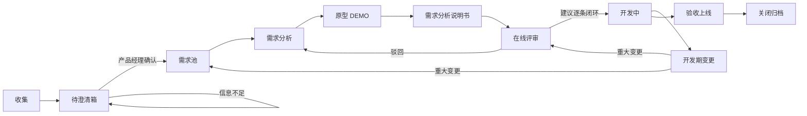
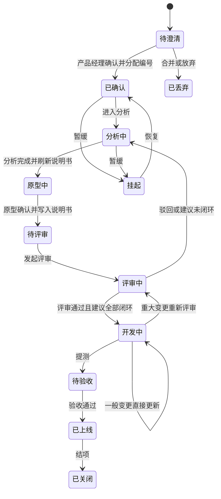
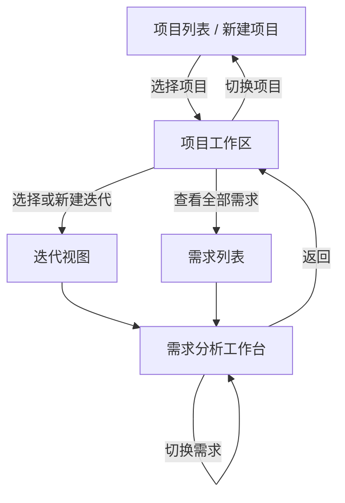
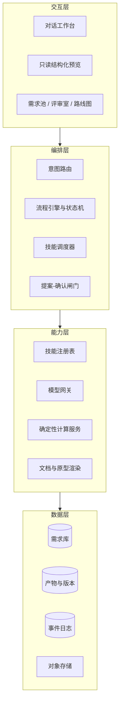
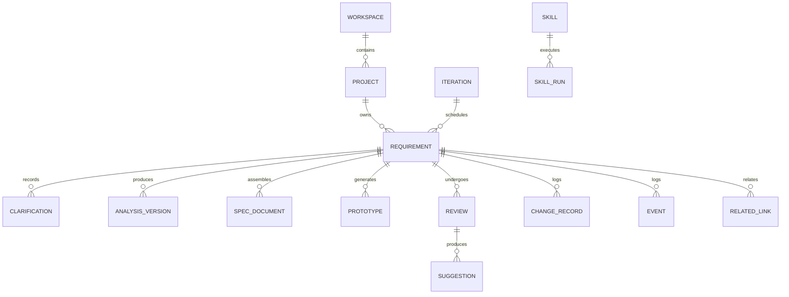

# 需求管理工作台 · 产品需求分析文档

| 项目 | 内容 |
| --- | --- |
| 文档版本 | v0.2（整合八条流程补充） |
| 日期 | 2026-11-04 |
| 状态 | 待评审 |
| 交付形态 | Qoder Sites 云端站点 · 单一 Web 工作台 |
| 使用范围 | 单产品团队内部，按角色划分权限 |
| 关联方法论 | prd-discovery / prd-context / prd-analysis / prd-visuals / prd-prototype / prd-assemble / prd-quality |
| 对应流水线 | requirements/pm-req-workbench/workbench-requirement |

---

## 0. 本版变更说明

v0.2 在 v0.1 的六环节骨架上，补齐了产品经理实际操作中的八条流程约束。核心变化有三处：

1. **需求在确认之前不进入正式管理**：新增"待澄清箱"，未确认的需求不分配编号、不进需求池、不参与评审与排期。
2. **分析、原型、说明书三者联动**：分析在会话中完成，右屏只读结构化呈现；分析完成即刷新需求清单与说明书；原型确认后回写说明书。
3. **评审与开发期变更都有硬门禁**：改进建议未逐条闭环不得进入开发；开发期重大变更必须重新登记或重新评审。

八条补充与本文档章节的对应关系：

| 补充 | 要求要点 | 落点章节 |
| --- | --- | --- |
| 1 | 确认后才有唯一标识并进入需求池，未确认属待澄清且无编号 | 2.1、2.3、5.2、8 |
| 2 | 澄清需初判涉及应用，确认信息全部留存并进入后续流程 | 5.1、7 |
| 3 | 会话绑定需求进入分析模式，右屏只读结构化呈现，自动提示关联需求 | 4.2、5.3、6.2 |
| 4 | 分析完成更新需求清单与说明书并提供预览 | 5.5、6.1 |
| 5 | 原型可预览交互与优化，同步更新说明书与原型 HTML，确认后写入文档 | 5.4、5.5 |
| 6 | 输出需求清单与说明书，清单可浏览导出，说明书 HTML 预览与 Word 导出 | 5.5、6.6 |
| 7 | 在线预览评审，记录意见，产出改进建议清单并逐条闭环，闭环后进入开发 | 5.6、2.4 |
| 8 | 开发期可细化，重大影响需重新登记或重新评审 | 5.7、8 |
| 9 | 页面层级：项目创建与切换、迭代选择、工作台五环节切换 | 2.6、4.2、5.10 |

---

## 1. 产品概述

### 1.1 背景与问题

产品经理的工作被拆散在多个工具里：需求从群聊、会议纪要、邮件和口头传达里来，分析靠个人经验，评审材料靠手工拼装，原型要等设计排期，状态靠人肉同步，迭代排期靠一张表格。

具体表现为六个断点：

| 断点 | 现状 | 后果 |
| --- | --- | --- |
| 收集 | 需求散落在聊天记录、文档、邮件里，靠人记忆汇总 | 漏需求、重复提、原始语境丢失 |
| 分析 | 建模与影响面判断全凭经验，没有统一口径 | 分析深度参差，研发反复追问 |
| 评审 | 材料临时拼，会上口头讲，结论落在纪要里 | 决议不可追溯，返工无据可查 |
| 原型 | 等设计资源，或用截图拼凑，交互说不清 | 验证周期长，理解偏差到开发才暴露 |
| 跟进 | 状态靠问，阻塞靠喊，风险靠感觉 | 跨版本信息断层，延期发现太晚 |
| 规划 | 优先级与容量靠估 | 迭代承诺失真，交付率低 |

同时，AI 目前多以聊天窗口的形式存在：能写出一段不错的分析，但产出停留在对话里，无法变成可校验、可流转、可追溯的工程资产。**能力有了，链路没通。**

### 1.2 产品定位

**用自然语言驱动、由技能编排、以代码保障确定性的需求管理中枢。**

它不是"给需求管理加一个 AI 助手"，而是把 AI 放在流程的正确位置：模型负责语义判断与生成，代码负责状态、校验、计算与权限，技能负责把方法论固化成可复用、可版本化的执行单元。

三层协同的基本分工：

| 层 | 负责什么 | 不负责什么 |
| --- | --- | --- |
| 自然语言层 | 理解意图、生成内容、解释理由、追问澄清 | 直接改数据、直接发通知、直接定优先级 |
| 技能层 | 承载分析方法论，产出符合契约的结构化结果 | 保存状态、做权限判断、计算排期 |
| 代码层 | 状态机、字段校验、一致性检查、评分计算、权限与审计 | 语义理解、文本生成、模糊判断 |

### 1.3 目标用户

| 角色 | 与产品的关系 | 主要诉求 |
| --- | --- | --- |
| 产品经理（主角色） | 全流程使用者，唯一可确认需求与关闭改进建议的角色 | 少填表、少切工具，想法快速变成可开发需求包 |
| 研发负责人 | 评审与排期参与者 | 信息完整、风险提前暴露、排期有依据 |
| 测试负责人 | 评审与验收参与者 | 验收标准明确、原型可点、变更可追踪 |
| 评审人 | 在线评审参与者 | 能标注、能留意见、能看见闭环 |
| 业务方 | 需求提出者 | 提需求简单、进度可见 |
| 管理者 | 观察者 | 全局视图、交付率、瓶颈定位 |

### 1.4 产品目标

1. 需求从登记到形成可开发需求包的中位耗时，从以天计降到 4 小时以内。
2. 需求关键字段完整度稳定在 90% 以上，减少研发追问。
3. 评审一次通过率达到 70% 以上，评审结论与改进建议 100% 可追溯。
4. 产品经理的机械操作步骤减少一半，把时间还给判断。
5. AI 提案一次采纳率达到 60% 以上——低于这个数，说明 AI 在制造噪音而非减少工作。

### 1.5 非目标（首版明确不做）

- 不做代码托管、CI/CD、发布流水线。
- 不做工时统计、甘特图与资源精细排班。
- 不做移动端 App，首版只做桌面浏览器。
- 不做套餐、账单与支付等商业化计费。
- 不让 AI 直接写生产代码，只生成原型与需求产物。

### 1.6 成功指标

| 指标 | 口径 | 首版目标 |
| --- | --- | --- |
| 需求登记到分析完成的中位时长 | 事件日志时间差 | ≤ 4 小时 |
| 关键字段完整度 | 必填项非空比例 | ≥ 90% |
| AI 提案采纳率 | 采纳提案数 / 提案总数 | ≥ 60% |
| 评审一次通过率 | 一次通过需求数 / 评审需求数 | ≥ 70% |
| 改进建议闭环率 | 闭环建议数 / 建议总数 | 100% |
| 单需求平均 AI 成本 | 模型调用费用 / 需求数 | 设预算上限并监控 |

---

## 2. 全流程与核心概念

### 2.1 两个池

产品经理面对的入口只有两个，边界必须清楚：

| 池 | 内容 | 是否有编号 | 可做的事 |
| --- | --- | --- | --- |
| 待澄清箱 | 刚进入系统、尚未被产品经理确认的需求 | 无 | 补信息、合并、关联、丢弃；不可评审、不可排期 |
| 需求池 | 经产品经理确认、已分配唯一编号的需求 | 有 | 分析、原型、评审、排期、跟进 |

规则：

- 需求从待澄清箱进入需求池的唯一通道是产品经理确认，没有旁路。
- 确认是不可逆的正式动作：编号一经分配不再更改，即使需求后续被关闭也保留编号。
- 待澄清箱里的条目可以随时合并或丢弃，不产生编号，也不进入任何统计口径。
- 待澄清箱同样需要留存原始材料与澄清记录，避免"没入池就等于没发生"。

### 2.2 主流程



关键点：

- 分析、原型、说明书是同一份需求的三次呈现，任何一次修改都要同步到说明书。
- 评审看的是说明书与原型，不是聊天记录。
- 开发中允许细化，但跨过影响阈值就要回到确认或评审环节。

### 2.3 需求编号与确认

**编号格式**：`REQ-<项目号>-<流水号>`，例如 `REQ-01-0007`。项目号标识所属项目或迭代，流水号在项目内递增。

**确认动作**：产品经理在确认页逐项核对以下清单，全部通过后点击确认。

| 确认项 | 判定标准 | 缺失时 |
| --- | --- | --- |
| 需求描述 | 用一句话能说清谁要做什么、达到什么目的 | 不可确认 |
| 角色与目标 | 至少一个明确角色与可验证的目标 | 不可确认 |
| 范围与边界 | 本期做什么、明确不做什么 | 不可确认 |
| 验收口径 | 可逐条判定通过与否 | 不可确认 |
| 初判涉及应用 | 至少一个应用，且来自项目系统范围 | 不可确认 |
| 优先级建议 | 给定初始优先级，允许后续调整 | 可确认，标记待定 |

确认后系统写入确认人、确认时间与确认时的字段快照。后续字段变化另存版本，不覆盖确认快照。

### 2.4 状态机



说明：

- "待澄清"对应待澄清箱，无编号；"已确认"及之后才在需求池。
- "开发中 → 开发中"的自循环代表一般变更：直接更新内容并留版本，不改变状态。
- 任何状态都可以被关闭，但需记录原因与操作人。

### 2.5 门禁规则

| 流转 | 前置条件 | 由谁执行 |
| --- | --- | --- |
| 待澄清 → 已确认 | 确认清单六项全部满足；操作人为产品经理 | 代码校验 + 产品经理操作 |
| 已确认 → 分析中 | 会话已绑定该需求 | 代码校验 |
| 分析中 → 原型中 | 分析四段结构完整；一致性校验无阻断项；说明书已刷新 | 代码校验 |
| 原型中 → 待评审 | 原型已确认；说明书已写入原型截图与链接，两者版本一致 | 代码校验 |
| 评审中 → 开发中 | 评审结论为通过；改进建议全部为已闭环状态 | 代码校验 + 产品负责人签署 |
| 开发中 → 待验收 | 验收标准可逐条判定；变更记录完整 | 代码校验 |
| 待验收 → 已上线 | 验收结论已登记 | 代码校验 |

门禁由代码执行，模型无权放行。任何例外需要管理员显式豁免并记录理由。

---

### 2.6 页面层级与导航

整体是三层结构，每一层只回答一个问题：在哪做、做什么、怎么改。



**第一层：项目层**

入口是项目列表，卡片展示项目名称、编号、类型、负责人、需求总数、进行中的迭代与最近更新时间。右上角提供新建项目入口。

新建项目按项目画像的顺序分四步，每步可保存草稿：

| 步骤 | 填写内容 | 校验 |
| --- | --- | --- |
| 1 基本信息 | 项目名称、编号、类型、背景与目标、负责人 | 名称与编号在团队内唯一 |
| 2 组织与人员 | 业务方、研发、测试，关键干系人与职责 | 至少一名产品经理 |
| 3 系统范围 | 平台、应用、模块，以及明确不做的范围 | 至少一个应用 |
| 4 交付约定 | 通知渠道、审批规则、数据权限、导出格式、迭代周期与容量单位 | 迭代周期与容量单位必填 |

创建完成后进入项目工作区。产品经理可在顶部项目切换器随时切换，切换时保留各项目上次停留的位置。

**第二层：项目工作区**

- 顶部全局栏：项目切换器、迭代选择器、全局搜索、通知、个人菜单。
- 左侧导航：概览、需求、迭代、评审、路线图、项目设置。
- 需求视图分两组：待澄清（无编号，不可排期）与需求池（有编号）。默认按状态分组，支持按迭代、负责人、涉及应用筛选。
- 迭代视图：迭代列表（名称、起止日期、容量、需求数、承诺与完成）、新建迭代入口、未排期需求区。选择迭代后，需求视图随之过滤，但可随时切回"全部迭代"。

**第三层：需求分析工作台**

从需求列表或迭代视图点击任一条需求进入。顶部固定显示返回入口、需求选择器、需求编号与标题、当前状态与负责人。

环节条固定五个：需求澄清、需求分析、原型输出、需求评审、需求调整。产品经理可自由切换环节查看，但写入受前置环节约束（见 4.2）。

左栏是唯一的操作入口，右栏随环节切换展示不同预览，关联需求固定在侧栏。切换需求时，会话按需求独立保存，切回来仍能接上。

### 2.7 环节与需求的对应关系

| 环节 | 面向的问题 | 主要产出 | 前置环节 |
| --- | --- | --- | --- |
| 需求澄清 | 这条需求到底要什么、还缺什么 | 澄清单、涉及应用初判、待澄清项 | 需求已进入待澄清箱 |
| 需求分析 | 业务怎么走、功能怎么拆、影响哪些系统 | 四段分析内容与版本 | 需求已确认入池 |
| 原型输出 | 界面长什么样、交互是否说得通 | 可交互原型与页面清单 | 分析四段完整 |
| 需求评审 | 方案是否成立、还有哪些问题 | 评审意见、改进建议清单、结论 | 原型已确认并写入说明书 |
| 需求调整 | 建议怎么消除、变更影响多大 | 新版本分析、原型与说明书，变更记录 | 已发起评审或已进入开发 |

"需求调整"同时承接两件事：评审后逐条消除改进建议，以及开发过程中细化需求。两者都走同一个环节，区别只在变更分级与是否需要重新评审。

需要明确的是，**环节是工作台的视图分组，不等于需求状态**。需求状态由 2.4 的状态机独立维护，两者通过门禁关联：用户在哪个环节查看都不改变状态，只有完成该环节的确认动作才会推动状态流转。

---

## 3. 产品设计原则

**原则一：自然语言是入口，结构化是确认面。**
用户可以用一句话发起任何操作，但任何写入事实的变更都要经过结构化确认。模型给出的是提案，不是结论。

**原则二：模型不发明操作。**
系统维护一份动作清单，模型只能从中选择动作并填充参数，不能自由构造操作。这是安全边界，也是可测试性的基础。

**原则三：能算的不要问模型。**
优先级打分、依赖拓扑、容量核算、覆盖率统计、状态合法性判断全部由代码完成。模型只在需要语义理解的环节出现。

**原则四：一切都是可追溯的产物。**
每次 AI 生成、每次人工修改、每次状态流转都留痕：谁、何时、基于哪版技能、用了哪个模型、改了什么。产物可导出、可对比、可回滚。

**原则五：技能即方法论，产物即契约。**
技能不是一段提示词，而是"提示词模板 + 输入契约 + 输出结构 + 产物模板 + 校验规则"的完整包。升级技能不改变产物结构，只提升质量。

**原则六：阅读与修改分离。**
分析面板、说明书预览、原型预览都是只读视图。修改只发生在会话里，避免同一份内容出现两个编辑入口导致版本分叉。

---

## 4. 总体架构

### 4.1 分层架构



### 4.2 需求分析工作台的界面布局

工作台是全产品的核心操作面，采用"顶部定位 + 环节条 + 左会话 + 右预览 + 关联侧栏"的固定结构：

```text
┌──────────────────────────────────────────────────────────────────────────────┐
│ ← 返回项目   需求切换器 [REQ-01-0007 订单改址 ▾]   状态：分析中   负责人：张工  │
├──────────────────────────────────────────────────────────────────────────────┤
│ 需求澄清  │  需求分析  │  原型输出  │  需求评审  │  需求调整                     │
├────────────────────────────────────────────────────┬─────────────────────────┤
│ 左栏：会话工作台                                     │ 右栏：本环节只读预览       │
│                                                    │                         │
│ · 当前环节：需求分析                                 │ （需求分析环节）          │
│ · 用户自然语言指令                                   │ 一、需求描述              │
│ · 模型回复、提案与差异摘要                            │ 二、业务流程说明          │
│ · 待确认事项                                        │ 三、功能设计              │
│ · 环节切换提示（可输入"切到原型"）                     │   · 功能架构图            │
│                                                    │   · 功能说明              │
│                                                    │   · 功能流程图            │
│                                                    │   · 辅助支撑功能          │
│                                                    │ 四、集成说明              │
│                                                    │   · 涉及的应用            │
│                                                    │   · 集成点说明            │
│                                                    │                         │
│ [输入框]                                            │ 版本 v3 · 校验通过        │
├────────────────────────────────────────────────────┴─────────────────────────┤
│ 关联需求：REQ-01-0003（强关联）· REQ-01-0011（同模块）· 展开查看详情            │
└──────────────────────────────────────────────────────────────────────────────┘
```

**右屏按环节切换**

| 环节 | 右屏内容 | 可执行动作 | 写入前置条件 |
| --- | --- | --- | --- |
| 需求澄清 | 澄清单与字段完成度、缺口与追问、涉及应用初判、来源材料片段 | 查看来源、逐项确认、跳转确认 | 需求在待澄清箱中 |
| 需求分析 | 四段结构：需求描述、业务流程说明、功能设计（架构图、说明、流程图、辅助支撑）、集成说明（涉及应用、集成点说明） | 折叠、跳转、查看差异、查看来源 | 需求已确认入池 |
| 原型输出 | 原型预览器（桌面与移动视口）、页面清单、当前页面说明、改稿版本对比 | 交互操作、切换页面、并排对比、确认原型 | 分析四段完整且校验通过 |
| 需求评审 | 说明书在线预览（目录 + 正文 + 原型截图）、批注工具、评审结论区、改进建议清单 | 批注、记录意见、签署结论 | 原型已确认并写入说明书 |
| 需求调整 | 改进建议清单与状态、变更记录与分级、影响面清单、说明书与原型版本差异 | 逐条处理、查看差异、提起重评 | 已发起评审或已进入开发 |

**布局约束**

- 右栏不可编辑，不提供输入框与保存按钮，只能滚动、折叠、跳转、批注与查看来源。
- 所有修改必须回到左栏用自然语言发起；模型生成提案后，右栏以高亮差异展示，经确认后更新。
- 会话与需求绑定关系显式展示在顶部；未绑定时会话处于普通问答模式，不产出分析内容。
- 环节可自由切换查看；不满足前置条件时，后续环节只读并提示缺少什么，避免用户误以为可以跳过。
- 同一需求只维护一条会话主线，切换环节不新开会话，避免上下文断裂；不同需求的会话彼此隔离。
- 切换需求时，当前会话自动保存，返回时可继续；未确认的提案在切换前提示保留或丢弃。
- 关联需求在侧栏展开详情时不跳转页面，返回后会话上下文不丢失。

### 4.3 技能包结构

每个技能在系统中以如下结构注册，与现有 prd-* 技能目录一一对应：

| 组成 | 作用 | 示例 |
| --- | --- | --- |
| 元信息 | 名称、版本、适用环节、依赖前置技能 | 结构化分析 v1.2，依赖澄清与上下文 |
| 输入契约 | 需要哪些字段、缺失时如何处理 | 必需角色、目标、范围；缺则先追问 |
| 提示词模板 | 方法论的具体表达，含输出格式约束 | 业务建模、领域建模、数据流的分解步骤 |
| 输出结构 | JSON Schema，机器可校验 | 实体、关系、流程、集成点为必填节点 |
| 产物模板 | 人读文档的章节骨架 | 与说明书章节一致 |
| 校验规则 | 结构、引用、覆盖率检查 | 每个功能必须挂到流程节点与应用 |

说明：云端站点无法直接调用本机技能目录，因此技能以"包"的形式上传注册，方法论一致、执行环境独立。本地技能目录是技能包的源，工作台是执行端。

### 4.4 模型网关

统一网关负责模型接入、密钥托管、调用计费、重试与降级。业务层只声明需要什么能力（结构化抽取、长文分析、代码生成、图像理解），由网关选择具体模型，模型换代不影响业务代码。

约束：

- 结构化输出必须走 JSON Schema 约束解码或二次校验，失败自动重试一次，仍失败转人工接管并保留原始响应。
- 支持用户级与工作空间级密钥，加密存储，不写入日志。
- 模型不可用时降级为纯表单流程，不阻断用户完成工作。

### 4.5 提案与确认

任何模型输出在写入数据库前先成为提案，在界面上以差异视图呈现：新增了什么字段、修改了什么结论、引用了哪些来源。用户确认后才落库，拒绝则记录拒绝原因用于优化技能。

确认分级：

| 类型 | 示例 | 确认方式 |
| --- | --- | --- |
| 只读 | 查询、解释、统计 | 直接执行 |
| 低风险写入 | 改标签、加备注、调整优先级 | 执行并提示，可撤销 |
| 高风险写入 | 确认需求、合并、变更状态、重写分析、确认原型 | 必须显式确认 |

### 4.6 产物链与技能对照

| 工作台环节 | 对应技能 | 沿用产物 | 在工作台中的形态 |
| --- | --- | --- | --- |
| 项目与画像 | prd-profile | 项目画像、范围定义 | 工作空间设置页 |
| 收集与澄清 | prd-discovery | 需求澄清、需求简报 | 待澄清卡片 + 澄清面板 |
| 上下文与资料 | prd-context | 上下文、来源索引 | 资料库 + 事实台账 |
| 设计规范 | prd-design-spec | 设计决策与令牌 | 原型主题面板 |
| 结构化分析 | prd-analysis | 分析文档、分析包、一致性报告 | 右栏四段预览 |
| 图表 | prd-visuals | 图表定义与截图 | 功能架构图、流程图 |
| 原型 | prd-prototype | 页面 HTML、原型清单 | 原型预览与批注 |
| 组装与质检 | prd-assemble / prd-quality | 说明书、质检报告 | 说明书预览与导出 |

新增的是确认入池、评审闭环与开发期变更三个环节，此前没有对应技能，属于本产品的新增能力。

---

## 5. 功能需求

### 5.1 需求收集与澄清

**目标**：让任意来源、任意形态的需求在三分钟内进入系统，并澄清到可以确认的程度。

**用户故事**

- 作为产品经理，我希望把群聊里的一段话直接粘进来，系统自动拆成结构化需求，不用手工填表。
- 作为产品经理，我希望系统主动问我还缺什么，而不是让我自己找漏。
- 作为需求分析人员，我希望澄清时就能看到这条需求大概会动到哪些应用，避免后面才发现跨系统。

**功能清单**

| 编号 | 功能 | 说明 | 优先级 |
| --- | --- | --- | --- |
| COL-01 | 对话式登记 | 一段自然语言创建需求，自动抽取标题、背景、角色、目标、范围 | P0 |
| COL-02 | 多形态导入 | 文本、Markdown、Word、PDF、Excel、PPT、图片上传解析 | P0 |
| COL-03 | 批量拆分 | 一段材料含多条诉求时拆成多张卡片并保留原文片段 | P0 |
| COL-04 | 相似需求检测 | 语义相似度与关键词双路比对，提示合并或关联 | P0 |
| COL-05 | 原始素材留存 | 每条需求保留来源文件与定位片段，可回跳原文 | P0 |
| COL-06 | 缺口识别与追问 | 按澄清契约判断缺失项，一次最多四题、每题给选项 | P0 |
| COL-07 | 涉及应用初判 | 依据项目系统范围推断可能涉及的应用，标注置信度 | P0 |
| COL-08 | 澄清记录留存 | 所有已确认信息结构化保存，供确认与分析直接引用 | P0 |
| COL-09 | 对外收集表单 | 发布表单，提交后自动进入待澄清箱 | P1 |
| COL-10 | 渠道接入 | 飞书或钉钉群消息、邮件转发自动登记 | P2 |

**模型、代码、技能的分工**

| 任务 | 模型 | 代码 | 技能 | 人工确认点 |
| --- | --- | --- | --- | --- |
| 长文抽取与拆分 | 语义抽取、拆分、归类 | 字段校验、去重阈值 | 需求登记 | 拆分结果确认 |
| 相似判断 | 生成语义向量与相似理由 | 向量检索、阈值判定 | 需求登记 | 合并或关联确认 |
| 缺口追问 | 生成选项化问题 | 题量与选项数约束 | 澄清协议 | 逐题选择 |
| 涉及应用初判 | 结合需求语义推断应用 | 与项目系统范围比对，越界即拦截 | 影响初判 | 逐项确认或修正 |

**关键交互**

- 输入："把这段客户反馈整理成需求，按紧急程度分一下。"
- 返回：需求卡列表 + 每张卡的字段完成度 + 缺失项 + 初判涉及应用。
- 继续："第二条缺验收标准，帮我列三个可选口径。"
- 初判应用超出项目系统范围时，系统明确提示："该需求涉及范围外系统，需要先更新项目范围或作为集成依赖处理。"

**验收标准**

1. 粘贴 1000 字以内材料，10 秒内返回拆分结果。
2. 一条材料含 3 条以上独立诉求时，拆分召回率达到 90%。
3. 每条需求都带来源定位，可一键回跳原文段落。
4. 初判涉及应用为空时不允许进入确认环节。
5. 初判结果与项目系统范围不一致时，必须给出明确提示，不得静默通过。

---

### 5.2 需求确认与入池

**目标**：把"确认"做成一个严肃的动作，让进入需求池的每一条需求都具备可分析、可评审、可验收的基本条件。

**用户故事**

- 作为产品经理，我希望确认前能一眼看到还差什么，而不是确认后才发现信息不全。
- 作为产品经理，我希望未经我确认的条目不要占用正式编号，也不要出现在排期里。
- 作为研发负责人，我希望需求池里没有半成品。

**功能清单**

| 编号 | 功能 | 说明 | 优先级 |
| --- | --- | --- | --- |
| CNF-01 | 确认清单校验 | 六项确认内容逐项判定，缺项阻断 | P0 |
| CNF-02 | 唯一编号分配 | 确认时分配 REQ-项目号-流水号，全局唯一 | P0 |
| CNF-03 | 确认快照 | 保存确认时的字段快照、确认人、确认时间 | P0 |
| CNF-04 | 待澄清箱管理 | 未确认条目的列表、合并、关联、丢弃 | P0 |
| CNF-05 | 需求池视图 | 正式需求的列表与看板，支持筛选与检索 | P0 |
| CNF-06 | 确认撤回 | 仅管理员可撤回，需记录理由并保留编号 | P1 |
| CNF-07 | 批量确认 | 信息齐备的多条需求批量确认 | P2 |

**模型、代码、技能的分工**

| 任务 | 模型 | 代码 | 人工确认点 |
| --- | --- | --- | --- |
| 确认前体检 | 解释缺项对后续的影响 | 六项字段校验、应用范围比对 | 产品经理逐项确认 |
| 编号分配 | 无 | 事务内取号，保证唯一与连续 | 无 |
| 快照留存 | 无 | 版本写入与差异计算 | 无 |

**关键交互**

- 确认页左侧显示澄清单，右侧显示"还差三项"与补全建议。
- 产品经理："把验收口径补成三条，然后确认。"
- 系统生成验收口径提案，确认后写入并分配编号，页面提示新编号与已入池状态。

**验收标准**

1. 未确认需求在任何列表、统计、排期视图中都不出现编号。
2. 编号在并发确认下不重复、不跳号。
3. 确认后修改字段，确认快照保持不变，差异可查看。
4. 非产品经理角色无法执行确认动作。

---

### 5.3 需求分析

**目标**：在对话中完成结构化分析，右屏所见即所得，但不可直接编辑。

**用户故事**

- 作为产品经理，我希望打开某条需求的会话，它就自动进入分析模式，不用反复说明背景。
- 作为产品经理，我希望右边一直显示当前分析结果，改一句话就能看到变化。
- 作为产品经理，我希望系统提醒我这条需求和池子里哪几条有关，避免重复建设。

**分析结构（右栏固定四段）**

| 段落 | 包含内容 | 说明 |
| --- | --- | --- |
| 一、需求描述 | 背景、角色、目标、范围、边界、验收口径 | 与确认快照对齐，变更有差异提示 |
| 二、业务流程说明 | 主流程、分支流程、业务规则 | 每步写清角色、输入、处理、输出、异常 |
| 三、功能设计 | 功能架构图、功能说明、功能流程图、辅助支撑功能 | 功能架构图体现层级；功能说明逐条写清；辅助支撑含权限、字典、日志、导入导出等 |
| 四、集成说明 | 涉及的应用、集成点说明 | 涉及应用来自项目系统范围；集成点写清方向、频率、数据与失败处理 |

**功能清单**

| 编号 | 功能 | 说明 | 优先级 |
| --- | --- | --- | --- |
| ANA-01 | 会话绑定需求 | 选择或跳转需求后自动进入分析模式 | P0 |
| ANA-02 | 四段结构化生成 | 按固定四段生成与更新分析内容 | P0 |
| ANA-03 | 只读预览 | 右栏禁止编辑，仅支持查看、折叠与跳转 | P0 |
| ANA-04 | 差异高亮 | 提案与当前版本的差异在右栏高亮 | P0 |
| ANA-05 | 关联需求识别 | 语义与实体比对，提示需求池中的相关需求 | P0 |
| ANA-06 | 关联详情查看 | 侧栏展开关联需求的关键信息，不打断当前会话 | P0 |
| ANA-07 | 分析完成刷新 | 分析定稿后刷新需求清单与说明书草稿 | P0 |
| ANA-08 | 一致性校验 | 四段之间、分析与原型之间的锚点校验 | P0 |
| ANA-09 | 变更影响重算 | 需求变更后重算受影响章节与原型页面 | P1 |
| ANA-10 | 事实台账 | 每条结论标注来源与置信度，推断项标记待确认 | P1 |

**模型、代码、技能的分工**

| 任务 | 模型 | 代码 | 技能 | 人工确认点 |
| --- | --- | --- | --- | --- |
| 四段内容生成 | 业务建模、领域建模、集成推理 | 结构校验、必填节点检查 | 结构化分析 | 逐段确认 |
| 只读呈现 | 无 | 差异计算、渲染、锚点绑定 | 无 | 无 |
| 关联识别 | 生成相似理由与关联点 | 向量检索、实体重合度、阈值 | 关联分析 | 采纳或忽略 |
| 一致性 | 无 | 引用完整性、覆盖率、锚点比对 | 无 | 问题处置 |

**关键交互**

- 打开 REQ-01-0007 的会话，右栏自动载入当前分析版本。
- 指令："补充异常场景，已发货订单不允许改地址。"
- 右栏在业务流程说明与业务规则处高亮新增内容，确认后落库。
- 侧栏提示："需求池中有 2 条相关需求：REQ-01-0003（同一客户）、REQ-01-0011（同属物流模块）。"

**验收标准**

1. 会话未绑定需求时，不产生任何分析产物。
2. 右栏不存在可编辑控件，所有修改都能在会话记录中找到对应指令。
3. 四段中任一必填节点缺失时，不得进入原型环节。
4. 关联提示可一键查看详情并返回，返回后会话上下文不丢失。
5. 同一需求的分析版本可对比、可回滚。

---

### 5.4 原型 DEMO

**目标**：不依赖设计资源，半小时内拿出可点击、可评审、与说明书一致的原型。

**用户故事**

- 作为产品经理，我希望分析完成后直接得到可点击原型，用来和业务方对齐。
- 作为产品经理，我希望用一句话改原型，而不是打开设计工具拖拽。
- 作为评审人，我希望在原型上直接指出问题，而不是描述"第二个页面那个按钮"。

**功能清单**

| 编号 | 功能 | 说明 | 优先级 |
| --- | --- | --- | --- |
| PRO-01 | 页面规划 | 从功能设计与流程推导页面清单与信息架构 | P0 |
| PRO-02 | 原型生成 | 生成可点击 HTML，覆盖默认、空、错误、成功状态 | P0 |
| PRO-03 | 设计规范遵循 | 采用统一令牌，规范未提供时使用中性基线 | P0 |
| PRO-04 | 交互预览 | 页面跳转、表单、弹窗、状态切换可操作 | P0 |
| PRO-05 | 自然语言改稿 | "把列表改成卡片""加一个筛选区"生成新版本 | P0 |
| PRO-06 | 双产物同步 | 改稿同时更新原型 HTML 与说明书相关章节 | P0 |
| PRO-07 | 确认后写入 | 原型确认后以截图与链接形式写入说明书 | P0 |
| PRO-08 | 版本对比 | 改稿前后并排对比，可回滚 | P1 |
| PRO-09 | 页面批注 | 框选标注并转为评审意见 | P1 |

**模型、代码、技能的分工**

| 任务 | 模型 | 代码 | 技能 | 人工确认点 |
| --- | --- | --- | --- | --- |
| 页面规划 | 由流程推导页面与跳转 | 页面可达性、锚点唯一性 | 原型规划 | 页面清单确认 |
| 页面生成 | 生成结构与样式 | 渲染校验、外链检查、状态覆盖 | 原型生成 | 整批或单页确认 |
| 改稿 | 理解修改意图并局部重写 | 差异比对、版本留存、死链检查 | 原型生成 | 改稿确认 |
| 写入说明书 | 生成页面说明文字 | 截图渲染、链接可达性、版本一致性 | 说明书组装 | 最终确认 |

**关键交互**

- 指令："生成原型，重点做订单详情和改地址两个页面。"
- 预览原型后："收货地址那块改成卡片，加一个'已发货不可修改'的提示。"
- 系统同步更新原型与说明书中"功能说明"的对应段落，并提示两处已同步。
- 确认无误后："确认原型，写入说明书。"

**验收标准**

1. 5 至 8 个页面的原型生成时间不超过 10 分钟。
2. 每个页面至少覆盖默认态与空态，关键页面覆盖错误态。
3. 原型内无死链，所有可点击元素都有响应。
4. 原型确认前，说明书中不出现该原型内容。
5. 确认写入后，说明书中的截图与链接指向同一版本。

---

### 5.5 需求分析说明书与需求清单

**目标**：分析与原型的成果自动沉淀为可交付、可评审、可导出的正式文档。

**用户故事**

- 作为产品经理，我希望分析完不用再手工拼文档，说明书自动就是最新的。
- 作为评审人，我希望直接在线看说明书，不用下载文件。
- 作为研发负责人，我希望拿到一份能直接排期的需求清单。

**产物定义**

| 产物 | 粒度 | 内容 | 用途 |
| --- | --- | --- | --- |
| 需求清单 | 需求池级 | 编号、名称、状态、优先级、负责人、涉及应用、迭代、更新时间 | 浏览、筛选、排期、导出 |
| 需求分析说明书 | 一需求一份，可汇编 | 需求描述、业务流程、功能设计、集成说明、原型、评审记录、变更记录 | 评审、交付、归档 |

**功能清单**

| 编号 | 功能 | 说明 | 优先级 |
| --- | --- | --- | --- |
| SPC-01 | 说明书自动生成 | 由分析版本与原型版本自动组装，不手工拼接 | P0 |
| SPC-02 | 在线 HTML 预览 | 目录导航、图页联动、原型可点 | P0 |
| SPC-03 | Word 导出 | 版式稳定，图、表、原型截图完整 | P0 |
| SPC-04 | 需求清单浏览 | 列表与看板切换，筛选、排序、检索 | P0 |
| SPC-05 | 需求清单导出 | 导出为 Excel，字段与界面一致 | P0 |
| SPC-06 | 版本管理 | 每次更新生成版本，可对比与回滚 | P0 |
| SPC-07 | 说明书汇编 | 按迭代或项目把多份说明书合成一册 | P1 |
| SPC-08 | 更新提醒 | 分析或原型变更后提示说明书已刷新 | P1 |
| SPC-09 | 质量校验 | 占位符、丢图、断链、章节缺失检查 | P0 |

**模型、代码、技能的分工**

| 任务 | 模型 | 代码 | 技能 | 人工确认点 |
| --- | --- | --- | --- | --- |
| 内容组织 | 提炼与衔接文字 | 章节结构、引用完整性 | 说明书组装 | 预览确认 |
| 渲染与导出 | 无 | HTML 渲染、Word 转换、图片打包 | 组装 | 导出确认 |
| 质量校验 | 无 | 占位符、断链、图文一致性 | 质检 | 问题处置 |

**关键交互**

- 分析定稿后，右侧提示"需求清单与说明书已更新，点击预览"。
- 预览页可直接跳到某段对应的会话记录，便于追溯结论来源。
- 导出时选择"仅当前需求"或"按迭代汇编"。

**验收标准**

1. 分析与原型任一更新后，说明书在 30 秒内完成刷新。
2. 说明书与需求清单中的状态、名称、负责人完全一致。
3. 导出的 Word 中无占位符、无丢图、无断链。
4. 每个版本可查看变更摘要，并可回滚到上一版。

---

### 5.6 需求评审与改进闭环

**目标**：在在线预览中评审，把口头意见变成有责任人、有状态的改进建议，并逐条销项。

**用户故事**

- 作为评审人，我希望一边看说明书和原型一边标注，不用另外记笔记。
- 作为产品经理，我希望评审意见是一条条可勾掉的清单，而不是一段会议纪要。
- 作为产品负责人，我希望建议没闭环的需求不要进入开发。

**功能清单**

| 编号 | 功能 | 说明 | 优先级 |
| --- | --- | --- | --- |
| REV-01 | 在线评审模式 | 说明书与原型进入批注态，可选中段落或页面元素 | P0 |
| REV-02 | 评审意见记录 | 记录意见内容、位置、提出人、时间、类型 | P0 |
| REV-03 | 改进建议清单 | 意见归并为建议，带编号、严重程度、责任人、状态 | P0 |
| REV-04 | 逐条闭环 | 产品经理通过会话修改分析，建议标记为已消除 | P0 |
| REV-05 | 不采纳处理 | 填写理由并提交评审人确认 | P0 |
| REV-06 | 结论登记 | 通过、有条件通过、驳回、挂起，必须填写理由 | P0 |
| REV-07 | 开发门禁 | 建议未全部闭环不得进入开发 | P0 |
| REV-08 | 评审档案 | 参与人、意见、结论、版本完整归档 | P0 |
| REV-09 | 异步评审 | 无会议场景下限期收集意见并汇总 | P1 |
| REV-10 | 建议质量分析 | 按类型统计驳回原因，反哺分析技能 | P2 |

**建议状态**

```text
待处理 → 处理中 → 已消除 → 已确认关闭
                 └→ 不采纳 → 评审人确认 → 已关闭
```

说明：

- "已消除"由产品经理标记，需关联到具体的说明书版本才能成立。
- "不采纳"必须填写理由，并由提出人确认后才算闭环。
- 评审人可重新打开已关闭建议，重新打开后需求立即退出开发状态并回到评审中。

**模型、代码、技能的分工**

| 任务 | 模型 | 代码 | 技能 | 人工确认点 |
| --- | --- | --- | --- | --- |
| 意见归并 | 将口语意见归为问题、建议、疑问 | 去重、聚类、编号 | 评审归纳 | 归类确认 |
| 闭环校验 | 无 | 状态机、版本关联、门禁判断 | 无 | 产品负责人签署 |
| 修改执行 | 按建议生成修改提案 | 差异计算、版本写入 | 结构化分析 | 逐条确认 |

**关键交互**

- 评审人在原型第二页标注"缺少发货后状态"，自动生成建议 S-003。
- 产品经理："处理 S-003，补一个已发货状态和对应提示。"
- 系统更新分析、原型与说明书，建议自动标记为已消除，等待评审人确认关闭。

**验收标准**

1. 每条建议都能定位到具体章节或原型页面。
2. 建议未全部闭环时，"进入开发"按钮不可用且给出原因。
3. 不采纳的建议必须有理由，且经过提出人确认。
4. 评审记录与结论可导出，参与人与时间完整。

---

### 5.7 开发期变更管理

**目标**：允许开发过程中细化需求，同时防止"边做边改"侵蚀已评审的范围。

**用户故事**

- 作为产品经理，我希望开发中发现的细节问题能直接说清楚，不用重走全流程。
- 作为研发负责人，我希望范围性变更必须重新评审，而不是悄悄变大。
- 作为管理者，我希望看到每次变更的影响与处置方式。

**变更分级**

| 等级 | 判定条件 | 处置方式 | 是否需要评审 |
| --- | --- | --- | --- |
| 一般变更 | 仅补充说明、修正措辞、调整字段标签、补充异常提示 | 直接更新，生成新版本，通知研发与测试 | 否 |
| 中等变更 | 调整页面交互、增加非核心功能点、修改业务规则细节，但不改变范围与集成 | 更新并记录，需评审人知会确认 | 知会即可 |
| 重大变更 | 新增或变更涉及应用、新增集成点、改变验收口径、改变范围边界 | 重新登记为新需求，或在原需求上重新发起评审 | 是 |

判定说明：

- 分级由代码依据规则计算，模型只负责解释影响，不决定等级。
- 系统范围内应用清单、集成点清单、验收口径三项任一变化，直接判定为重大。
- 产品经理可以上调等级，不能下调；下调需管理员豁免并记录理由。

**功能清单**

| 编号 | 功能 | 说明 | 优先级 |
| --- | --- | --- | --- |
| CHG-01 | 变更发起 | 在需求会话中直接提出变更 | P0 |
| CHG-02 | 影响评估 | 计算受影响的章节、原型页面、应用与集成点 | P0 |
| CHG-03 | 自动分级 | 按规则判定一般、中等、重大 | P0 |
| CHG-04 | 分级处置 | 直接更新、知会确认、重新评审或重新登记 | P0 |
| CHG-05 | 变更记录 | 变更原因、影响、处置、操作人完整留痕 | P0 |
| CHG-06 | 新需求派生 | 从原需求派生新需求，继承背景与关联 | P1 |

**验收标准**

1. 涉及应用或集成点变化时，系统强制判定为重大变更。
2. 一般变更不改变需求状态，但必须产生新版本与通知。
3. 派生新需求时，原需求保留并相互关联，不复制编号。
4. 任何变更都能在时间线中看到"改了什么、为什么改、谁批的"。

---

### 5.8 状态跟进

**目标**：状态由系统事实驱动，而不是靠人汇报。

**功能清单**

| 编号 | 功能 | 说明 | 优先级 |
| --- | --- | --- | --- |
| TRK-01 | 状态机管理 | 固定状态与合法流转，禁止越级 | P0 |
| TRK-02 | 时间线 | 每条需求的事件流，可回放 | P0 |
| TRK-03 | 阻塞项管理 | 原因、责任人、预计解除时间 | P0 |
| TRK-04 | 风险预警 | 超期、缺产物、建议未闭环、依赖未满足 | P0 |
| TRK-05 | 我的待办 | 汇总待确认、待处理建议、待签署评审 | P0 |
| TRK-06 | 进展摘要 | 按日或周生成摘要，可编辑后发送 | P1 |
| TRK-07 | 变更追踪 | 变更记录与影响范围 | P1 |
| TRK-08 | 交付看板 | 按迭代统计承诺量、完成量、阻塞量 | P2 |

**验收标准**

1. 任何状态流转都有操作人、时间、前后状态与触发依据。
2. 风险命中后 5 分钟内出现在相关人待办中。
3. 摘要中的数字与看板一致，模型不得自行编造数值。
4. 需求详情页可完整回放从登记到当前的全部事件。

---

### 5.9 迭代规划

**目标**：让排期成为有约束的取舍，并让取舍的代价可见。

**功能清单**

| 编号 | 功能 | 说明 | 优先级 |
| --- | --- | --- | --- |
| PLN-01 | 优先级评分 | RICE 为主，支持战略权重与合规一票否决 | P1 |
| PLN-02 | 容量管理 | 团队、人日、迭代周期，按角色拆分 | P1 |
| PLN-03 | 依赖图 | 需求依赖可视化，环形依赖拦截 | P1 |
| PLN-04 | 排期编辑 | 拖拽分配迭代，实时校验容量与依赖 | P1 |
| PLN-05 | 冲突检测 | 依赖倒挂、容量超限、评审未闭环即时提示 | P1 |
| PLN-06 | 方案模拟 | 砍掉或挪动的下游影响 | P2 |
| PLN-07 | 路线图 | 季度视图，按主题分组 | P2 |
| PLN-08 | 承诺与交付对比 | 迭代结束后统计兑现率 | P2 |

**关键约束**

- 只有状态为"开发中"及之后、且评审建议全部闭环的需求可被排入迭代。
- 容量超限时排期不可发布，必须明确显示超出的人日数与来源。
- 存在环形依赖时给出闭环路径，不允许静默通过。

---

### 5.10 项目与迭代管理

**目标**：让产品经理能在一处管理多个项目与多个迭代，并清楚知道当前在哪个项目、哪个迭代、哪条需求上。

**用户故事**

- 作为产品经理，我希望按项目画像的字段一步步创建项目，而不是面对一张空白表单。
- 作为产品经理，我希望在多个项目之间快速切换，并且切回来时还在原来的位置。
- 作为产品经理，我希望在项目里按迭代查看需求，也能随时新建一个迭代。
- 作为产品经理，我希望从需求列表直接进入需求分析工作台，不用在页面之间反复跳。

**功能清单**

| 编号 | 功能 | 说明 | 优先级 |
| --- | --- | --- | --- |
| PRJ-01 | 项目列表 | 卡片展示项目概况，支持搜索、排序与最近访问 | P0 |
| PRJ-02 | 新建项目向导 | 按基本信息、组织人员、系统范围、交付约定四步创建 | P0 |
| PRJ-03 | 项目画像编辑 | 创建后仍可修改画像，变更留痕并提示影响 | P0 |
| PRJ-04 | 项目切换器 | 顶部常驻，显示当前项目，切换保留停留位置 | P0 |
| PRJ-05 | 项目成员与角色 | 邀请成员并分配角色，权限按角色生效 | P0 |
| PRJ-06 | 项目模板 | 从已有项目复制范围与约定快速建项 | P2 |
| ITR-01 | 迭代列表 | 名称、起止、容量、状态、需求数、承诺与完成 | P0 |
| ITR-02 | 新建迭代 | 名称、起止日期、容量、迭代目标 | P0 |
| ITR-03 | 迭代选择器 | 顶部常驻，切换后需求视图随之过滤 | P0 |
| ITR-04 | 未排期需求区 | 已确认但未分配迭代的需求集中呈现 | P0 |
| ITR-05 | 迭代关闭与归档 | 迭代结束后锁定并保留历史视图 | P1 |
| ITR-06 | 迭代容量校验 | 排入需求超出容量时提示并阻断发布 | P1 |

**模型、代码、技能的分工**

| 任务 | 模型 | 代码 | 人工确认点 |
| --- | --- | --- | --- |
| 建项引导 | 从一段描述中预填项目名称、背景与目标 | 字段校验、唯一性校验 | 四步逐项确认 |
| 画像变更影响 | 解释字段变化对下游分析的影响 | 差异计算、受影响需求检索 | 变更确认 |
| 迭代建议 | 根据历史交付解释容量是否合理 | 容量核算、承诺完成统计 | 迭代目标确认 |

**关键交互**

- 项目列表点击"新建项目"，输入"做一个售后工单系统"，系统预填名称与背景，产品经理逐步补全范围与约定。
- 在项目工作区顶部切换项目，页面回到该项目上次停留的需求或迭代。
- 新建迭代："建一个 11 月上半月的迭代，容量 40 人日。"
- 在需求列表点击一条需求，进入工作台并停在"需求分析"环节；返回后列表保持原有筛选与滚动位置。

**验收标准**

1. 新建项目四步均可保存草稿，任一步失败不丢失已填内容。
2. 项目名称与编号在团队内唯一，重复时明确提示。
3. 切换项目或迭代后，需求视图的筛选条件与停留位置正确恢复。
4. 未排期需求不会因为切换迭代而消失。
5. 非项目成员无法看到该项目及其需求。


---

## 6. 贯穿能力

### 6.1 自然语言工作台

全站唯一的对话入口，可发起查询、执行动作、解释结果。

处理链路：意图识别 → 匹配动作清单 → 参数抽取与补全 → 权限校验 → 变更预演 → 用户确认 → 执行 → 事件留痕。

动作清单是封闭集合，例如：创建需求、确认需求、绑定需求、更新分析、生成原型、改稿、确认原型、写入说明书、发起评审、提交建议、关闭建议、变更状态、分配迭代。模型只能从中选择，不能自由构造。

指令示例：

- "把这份会议纪要里的需求提出来，按模块归类。"
- "这条需求还缺什么，直接问我。"
- "打开 REQ-01-0007，补充已发货不可改址的规则。"
- "生成原型，重点做订单详情和改地址两页。"
- "把第二页的表格改成卡片，加一个搜索框。"
- "确认原型，写入说明书。"
- "发起评审，评审人加上研发和测试负责人。"
- "处理评审建议 S-003 和 S-005。"
- "这周哪些需求卡住了，原因是什么。"

### 6.2 关联需求

- 分析时自动比对需求池中的其它需求，依据语义相似度、实体重合度与应用重合度给出关联提示。
- 关联提示分级：强关联（可能重复）、弱关联（同模块）、依赖关联（上下游）。
- 提示是建议不是事实，需人工采纳后才建立正式关联。
- 关联详情在侧栏展开，显示摘要、状态、负责人与共同涉及的应用，支持跳转后返回原会话。

### 6.3 通知与协同

- 站内通知中心，聚合待办、@提及、状态变更。
- 外部渠道：邮件，后续扩展飞书或钉钉 webhook。
- 通知由模板与事件触发，模型只参与摘要文字，不参与触发判定。

### 6.4 权限与审计

权限判断在服务端完成，前端隐藏不作为安全手段。AI 执行动作时以发起人身份运行，权限不放大。所有 AI 调用与数据导出记入审计日志。

### 6.5 模型与技能管理

- 模型配置：按能力声明选择模型，支持多模型并存与降级。
- 密钥管理：用户级或工作空间级，加密存储，不落日志。
- 技能管理：启用停用、版本切换、执行记录与失败率统计。
- 成本看板：按环节、按模型、按需求统计调用量与费用。

### 6.6 导出与集成

- 需求清单导出 Excel，字段与界面一致，可勾选列。
- 说明书导出 Word，支持单份与汇编。
- 说明书在线预览为自包含 HTML，图片与原型截图内嵌，不依赖外链。
- 后续可扩展与代码仓库、缺陷系统对接，但不在首版范围。

---

## 7. 数据模型



| 实体 | 关键字段 | 说明 |
| --- | --- | --- |
| 工作空间 Workspace | 名称、成员、设置 | 团队级隔离单位 |
| 项目 Project | 名称、画像、状态、设计规范引用 | 需求的组织容器 |
| 需求 Requirement | 编号（确认前为空）、标题、类型、状态、优先级、负责人、来源、父需求、涉及应用 | 核心对象 |
| 澄清记录 Clarification | 轮次、问题、回答、形成结论、确认人 | 确认的输入 |
| 分析版本 AnalysisVersion | 版本号、四段内容、模型、技能版本、生成时间 | 结构化的分析产物 |
| 说明书 SpecDocument | 版本、格式、关联分析版本、关联原型版本、构建状态 | 正式交付物 |
| 原型 Prototype | 页面清单、版本、分享设置、确认状态 | 验证载体 |
| 评审 Review | 参与人、时间、结论、理由、依据版本 | 决策记录 |
| 改进建议 Suggestion | 编号、内容、位置锚点、提出人、严重程度、状态、关联版本 | 闭环对象 |
| 变更记录 ChangeRecord | 等级、原因、影响范围、处置方式、操作人 | 开发期变更 |
| 关联链接 RelatedLink | 源需求、目标需求、关联类型、置信度、是否采纳 | 需求之间关系 |
| 迭代 Iteration | 周期、容量、状态 | 排期单位 |
| 事件 Event | 类型、主体、前后状态、操作人、时间 | 全链路留痕 |
| 技能执行 SkillRun | 技能版本、输入、输出、模型、耗时、状态 | 可观测性基础 |

设计说明：

- 需求编号在确认前为 null，这是"未确认不入池"的数据层保证。
- 分析版本、说明书版本、原型版本三者互相引用，保证"说明书里看到的就是那一版"。
- 事件表只追加不修改，是审计与统计的唯一事实来源。
- 关联链接区分"系统提示"与"人工采纳"，未采纳的提示不进入需求详情。

---

## 8. 权限模型

| 角色 | 待澄清箱 | 需求池 | 分析 | 原型 | 说明书 | 评审 | 迭代 | 设置 |
| --- | --- | --- | --- | --- | --- | --- | --- | --- |
| 管理员 | 全部 | 全部 | 全部 | 全部 | 全部 | 全部 | 全部 | 全部 |
| 产品负责人 | 全部 | 全部 | 全部 | 全部 | 全部 | 签署 | 全部 | 项目级 |
| 产品经理 | 全部 | 本人及协作 | 本人需求 | 本人需求 | 生成与导出 | 发起与闭环 | 提交 | 只读 |
| 研发负责人 | 查看 | 参与 | 查看与评论 | 查看与评论 | 查看 | 参与 | 编辑 | 只读 |
| 测试负责人 | 查看 | 参与 | 查看 | 查看与评论 | 查看 | 参与 | 查看 | 只读 |
| 业务方 | 提交 | 查看 | 无 | 无 | 查看 | 无 | 无 | 无 |
| 观察者 | 只读 | 只读 | 只读 | 只读 | 只读 | 只读 | 只读 | 无 |

补充约束：

- 确认需求、关闭改进建议、确认原型写入说明书，仅产品经理可执行。
- 评审签署仅产品负责人可执行。
- 撤回已确认需求仅管理员可执行，需记录理由。
- 分享链接可设置有效期与访问范围，对外默认只读。

---

## 9. 非功能需求

| 类别 | 要求 |
| --- | --- |
| 性能 | 首屏 2 秒内；千条需求列表滚动流畅；对话首 token 3 秒内；说明书刷新 30 秒内 |
| 可用性 | 核心链路 99.5%；模型不可用时降级为纯表单流程，不阻断工作 |
| 并发 | 支持 50 人同时在线；同一需求编辑冲突以乐观锁提示 |
| 安全 | 密钥加密存储；传输与存储加密；敏感字段脱敏；操作全量审计 |
| 数据 | 每日备份保留 30 天；删除为软删除，保留可恢复窗口 |
| 可扩展 | 技能热插拔；模型可替换；动作清单可扩展而不改前端 |
| 可观测 | 记录模型调用的耗时、token、成本、失败率；按环节统计采纳率 |
| 兼容 | 桌面浏览器为主，原型预览支持移动端视口 |
| 交付 | 说明书预览为自包含 HTML，不依赖 CDN |

---

## 10. 迭代计划

按"先打通、再加深、后扩展"推进。首版选择全链路最小闭环，每个环节可用但不做满。

**第一阶段 · 骨架与闭环（约 4 周）**

- 工作空间、项目、待澄清箱、需求确认与编号、需求池、状态机、事件日志。
- 对话工作台与动作清单，支持查询与低风险写入。
- 模型网关与密钥配置，技能注册表跑通一个技能。

**第二阶段 · 分析与说明书（约 3 周）**

- 多源导入、拆分、去重与澄清追问。
- 涉及应用初判与项目范围比对。
- 会话绑定与右屏四段只读预览，关联需求识别。
- 分析完成自动刷新需求清单与说明书草稿，HTML 预览与 Word 导出。

**第三阶段 · 原型与回写（约 3 周）**

- 页面规划、原型生成、交互预览与自然语言改稿。
- 改稿同时更新原型与说明书，确认后写入说明书。
- 版本对比与回滚。

**第四阶段 · 评审与变更（约 3 周）**

- 在线评审模式、意见记录、改进建议清单与逐条闭环。
- 开发门禁与评审档案。
- 开发期变更分级、影响评估与重新登记。

**第五阶段 · 跟进与打磨（约 2 周）**

- 风险预警、我的待办、进展摘要。
- 优先级、容量、依赖与排期。
- 通知、成本看板、性能优化与端到端演练。

每阶段结束交付可演示版本，不做最后一并集成。

---

## 11. 风险与开放问题

### 11.1 风险

| 风险 | 影响 | 应对 |
| --- | --- | --- |
| 模型输出不稳定 | 分析质量波动，用户失去信任 | 结构校验 + 重试 + 人工接管，全量留痕 |
| 右屏只读被绕过 | 出现两个编辑入口，版本分叉 | 前端不提供入口，服务端拒绝非会话来源的分析写入 |
| 建议闭环流于形式 | "已消除"但内容没变 | 关闭建议必须关联具体说明书版本，差异为空则驳回 |
| 变更分级误判 | 范围悄悄扩大 | 关键三项变化强制判定重大，只上调不下调 |
| AI 成本失控 | 预算超支 | 按环节设 token 预算、结果缓存、低价值调用改规则 |
| 用户不愿改变习惯 | 采纳率低 | 保留导入导出，允许只用单个环节渐进接入 |
| 需求数据敏感 | 合规风险 | 字段级权限、导出审计、后续提供私有化选项 |

### 11.2 待确认事项

| 编号 | 问题 | 当前临时口径 |
| --- | --- | --- |
| Q-001 | 设计规范尚未提供 | 先按中性基线，令牌集中管理便于替换 |
| Q-002 | 需求清单导出格式 | 先按 Excel |
| Q-003 | 原型写入说明书的形式 | 截图 + 可点击链接 |
| Q-004 | 关联需求识别的阈值与人工标注 | 语义相似度 + 人工确认 |
| Q-005 | 评审人最少人数 | 至少两人 |
| Q-006 | 需求确认后是否允许更换负责人 | 允许，需记录变更 |
| Q-007 | 迭代容量采用人日还是故事点 | 人日 |

---

## 12. 端到端验收

首版验收以"一条真实需求走完全程"为核心场景，不接受分环节单独演示通过。

**页面走查**

- 从项目列表新建项目，四步填完后进入工作区；切换到另一个项目再切回，停留位置正确恢复。
- 在工作区新建迭代并切换，需求视图按迭代正确过滤，未排期需求仍可见。
- 点击需求进入工作台，五个环节可自由切换；不满足前置条件的环节只读并说明缺什么。
- 切换需求后会话彼此独立，切回原需求仍能接上上下文。

**流程走查**

1. 粘贴一段真实会议纪要，系统拆分出多条需求进入待澄清箱，均无编号。
2. 产品经理补齐角色、目标、范围、验收与涉及应用，逐条确认，系统分配唯一编号并入池。
3. 打开某条需求的会话，右栏载入四段分析；用自然语言补充业务规则，右栏高亮差异并确认。
4. 系统提示两条关联需求，展开查看详情后返回，会话上下文不丢失。
5. 分析定稿后，需求清单与说明书自动刷新，在线预览正常，Word 导出无占位符与丢图。
6. 生成原型并交互预览，用一句话改稿，原型与说明书对应段落同时更新。
7. 确认原型后，说明书出现该原型的截图与链接，版本一致。
8. 发起在线评审，评审人在原型上标注，系统生成改进建议。
9. 产品经理逐条处理建议直至全部闭环，评审通过，需求进入开发。
10. 开发中提出修改：一次一般变更直接更新并通知；一次涉及新增集成点的变更被判定为重大，转入重新评审。
11. 全流程事件可回放，任一步骤的 AI 产物都能追溯到技能版本、模型与发起人。

**质量底线**

- 任何环节不得出现占位符文本或未填模板。
- 任何 AI 生成的数字类结论必须来自代码计算，模型不得自行编造。
- 任何状态流转都必须通过门禁校验，无静默跳过路径。
- 任何导出产物与系统内数据一致，导出后仍可追溯到来源。

---

*本文档为 v0.2 初稿，待与产品、研发、测试三方评审后进入详细设计与原型阶段。*
