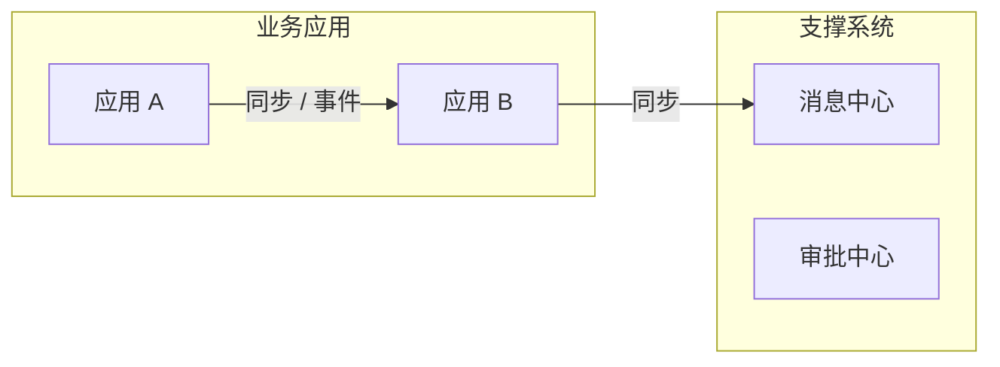

# 需求上下文

> 项目：AI驱动需求管理工作台建设 ｜ 项目编号：PRJ-20261104-140723-b3f4 ｜ 生成：2026-11-04
> 用途：为结构化需求分析提供可追溯的“既有事实基线”。事实必须带来源，推断必须明确标记。

## 0. 导读与完成度

| 项 | 内容 |
| --- | --- |
| 已收集来源数 |  |
| 强相关来源数 |  |
| 高置信事实数 |  |
| 关键资料缺口 |  |
| 是否允许在假设下继续 | 是 / 否（说明） |

## 1. 执行摘要

- 本需求涉及的业务领域：
- 主要应用系统：
- 既有能力可复用的部分：
- 最需要警惕的约束 / 冲突：
- 对需求分析的关键结论：

## 2. 事实台账

| 编号 | 事实 / 结论 | 来源 | 置信度 | 对需求的影响 |
| --- | --- | --- | --- | --- |
| FACT-001 |  | SRC-001 §章节 | 高 / 中 / 低 |  |

> 置信度：高 = 原文明确且版本有效；中 = 可推断但有歧义；低 = 仅口头线索或需验证。

## 3. 项目 / 产品 / 应用地图

| 应用编号 | 应用 / 系统 | 业务职责 | 所属领域 | 关键模块 | 现状 | 来源 |
| --- | --- | --- | --- | --- | --- | --- |
| APP-001 |  |  |  |  | 已上线 / 规划 / 在建 | SRC-001 |

### 3.1 应用架构图

> 只画有来源的应用与集成方向；没有材料时标注“基线未覆盖，待确认”，不臆造模块。

### 3.2 应用 → 模块 → 功能 → 页面分层

| 应用 | 模块 | 功能 | 页面 / 入口 | 状态 | 来源 |
| --- | --- | --- | --- | --- | --- |
|  |  |  |  | 已上线 / 规划 |  |

### 3.3 应用间集成关系

| 编号 | 来源应用 | 目标应用 | 对象 / 内容 | 方式 | 方向 | 关键字段 / 幂等 | 来源 |
| --- | --- | --- | --- | --- | --- | --- | --- |
| INT- |  |  |  | REST / 消息 / 文件 | 出 / 入 |  |  |

### 3.4 产品基线与设计规范来源

| 项 | 结论 | 版本 / 路径 | 来源 |
| --- | --- | --- | --- |
| 产品基线 | 已有 / 新建 / 待补 | `baselines/...` |  |
| 设计规范 | 已有 / 新建 / 补充 / 中性基线 |  |  |
| 标准页面 | 登录 / 首页 / 列表 / 新增编辑 / 详情 / 弹窗 |  |  |
| 设计规范决策候选 | `new_system_spec` / `existing_spec` / `supplement_spec` / `neutral_baseline` |  |  |

> 设计规范的最终决策与确认记录在 `03-design/design-decision.json`；本表只登记事实与候选结论。

## 4. 历史规划与版本

| 规划 / 文档 | 版本 | 日期 | 有效期 / 状态 | 与本需求相关的结论 | 来源 |
| --- | --- | --- | --- | --- | --- |
|  |  |  |  |  |  |

## 5. 历史需求、方案与可复用资产

### 5.1 已实现功能基线

| 功能 / 模块 | 所在应用 | 已实现能力 | 复用方式 | 来源 |
| --- | --- | --- | --- | --- |
|  |  |  | 直接复用 / 扩展 / 不改动 |  |

### 5.2 可复用领域实体与规则

| 实体 / 规则 | 关键属性 / 规则 | 所属领域 | 复用建议 | 来源 |
| --- | --- | --- | --- | --- |
| ENT- |  |  |  |  |

### 5.3 既有集成

| 编号 | 来源系统 | 目标系统 | 对象 / 内容 | 方式 | 关键字段 / 幂等 | 来源 |
| --- | --- | --- | --- | --- | --- | --- |
| INT- |  |  |  |  |  |  |

### 5.4 产品基线

| 基线文件 | 系统 / 应用 | 版本 | 更新时间 | 覆盖范围 | 未覆盖模块 |
| --- | --- | --- | --- | --- | --- |
| `baselines/<系统>-产品基线说明-v<版本>.md` |  |  |  |  | 基线未覆盖，待确认 |

## 6. 术语与领域实体

| 术语 | 业务定义 | 同义词 / 易混淆词 | 来源 |
| --- | --- | --- | --- |
|  |  |  |  |

## 7. 组织、权限与合规约束

- 组织结构 / 数据隔离方式：
- 角色与权限边界：
- 审计、隐私、合规要求：
- 数据保留 / 导出限制：

## 8. 风险、冲突与待确认

| 编号 | 风险 / 冲突 | 证据 | 影响 | 建议处理 | 需要谁确认 |
| --- | --- | --- | --- | --- | --- |
| RISK-001 |  |  |  |  |  |

## 9. 证据缺口

| 缺口 | 为什么需要 | 缺失影响 | 可采用的临时假设 |
| --- | --- | --- | --- |
|  |  |  |  |

## 10. 来源索引

> 完整机器索引见 `source-index.json`。此处列可读索引。

| 来源编号 | 类型 | 标题 / 文件 | 版本 / 日期 | 存放位置 | 相关度 |
| --- | --- | --- | --- | --- | --- |
| SRC-001 | 规划方案 / 历史 PRD / 知识库 / 记忆 / 对话 / 截图 |  |  | `sources/...` | 高 / 中 / 低 |
